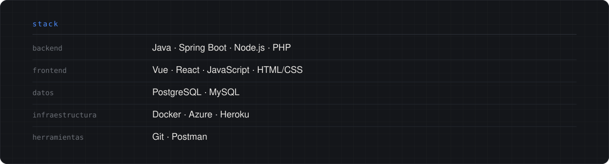

Estudio Ingeniería en Sistemas en la Universidad Mariano Gálvez, en Guatemala.

Me enfoco en sistemas web para negocios: inventarios, pedidos, citas, reportes, todo lo que hoy se lleva en Excel o en papel y debería estar en un sistema. Me interesa que el software sea útil para quien lo usa todos los días, no solo que funcione.

### Proyectos

**[MedNova](https://github.com/DanielGLima/REPO)** &nbsp;`Spring Boot` `React`
Gestión hospitalaria: pacientes, citas y personal médico en un solo sistema.

**[Patrón Electoral](https://github.com/DanielGLima/REPO)** &nbsp;`Java` `Spring Security`
API REST con autenticación y control de acceso por roles.

**[Pastelería](https://github.com/DanielGLima/REPO)** &nbsp;`PHP` `MySQL` `Vue 3`
Pedidos y productos para un negocio pequeño. Vue sin build, así corre en cualquier hosting barato.

**[Sistema de Quejas](https://github.com/DanielGLima/REPO)**
Registro y seguimiento de quejas de clientes para un restaurante.

**[API de usuarios](https://github.com/DanielGLima/REPO)** &nbsp;`Node.js` `PostgreSQL` `Docker`
CRUD completo y contenerizado: se levanta con un solo comando.

---

Tomo proyectos freelance: **sistemas a la medida**, **páginas para negocios** y **mejoras a sistemas que ya existen**.

[Correo](mailto:tucorreo@ejemplo.com) · [LinkedIn](https://linkedin.com/in/TU-USUARIO) · [WhatsApp](https://wa.me/502XXXXXXXX)
